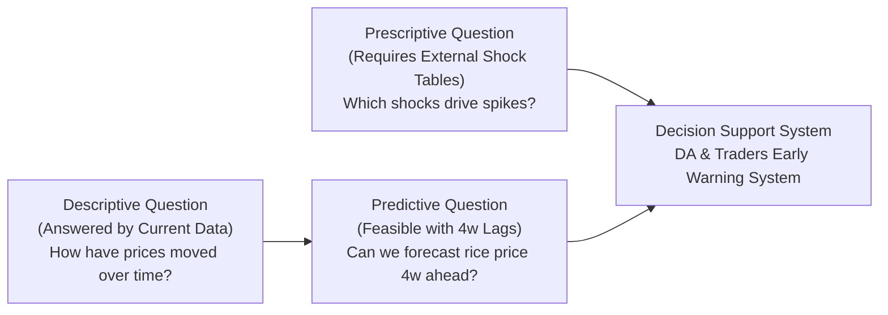
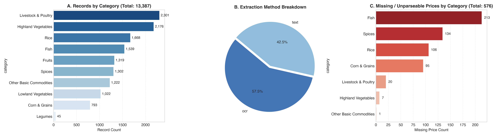
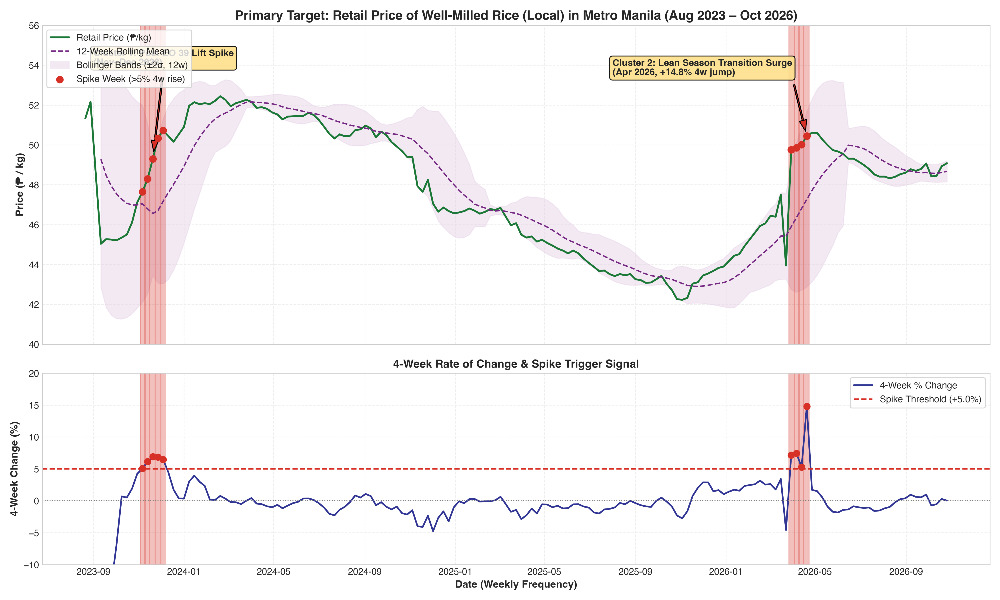
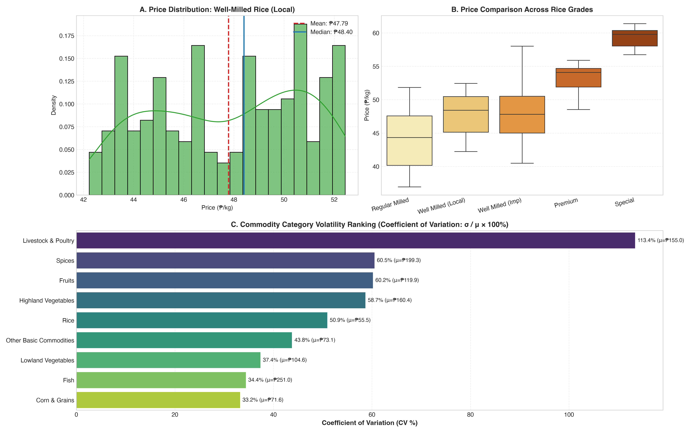
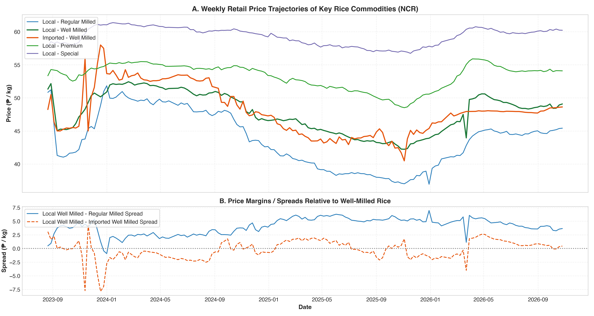
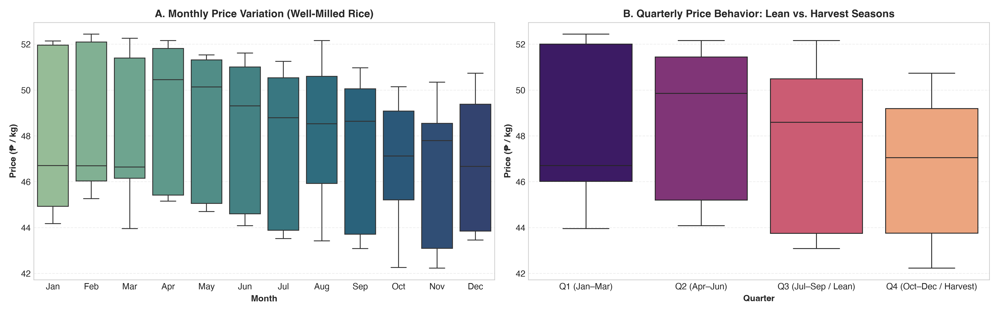
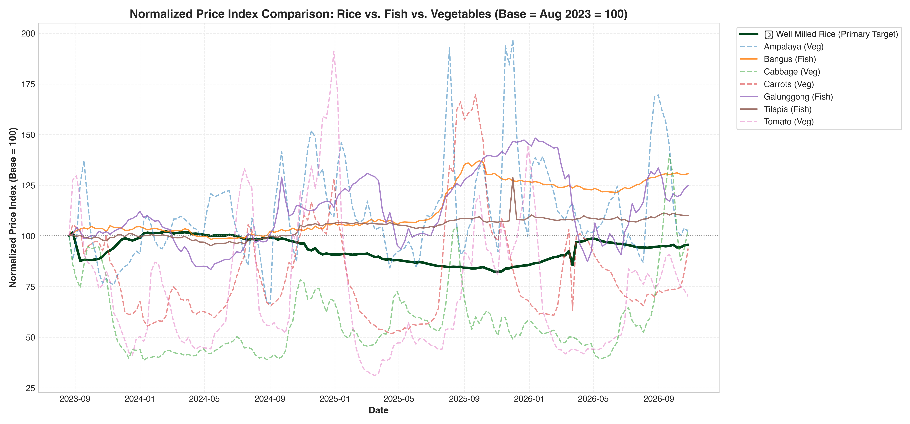
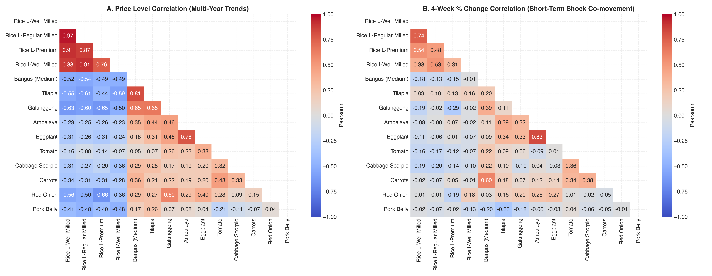
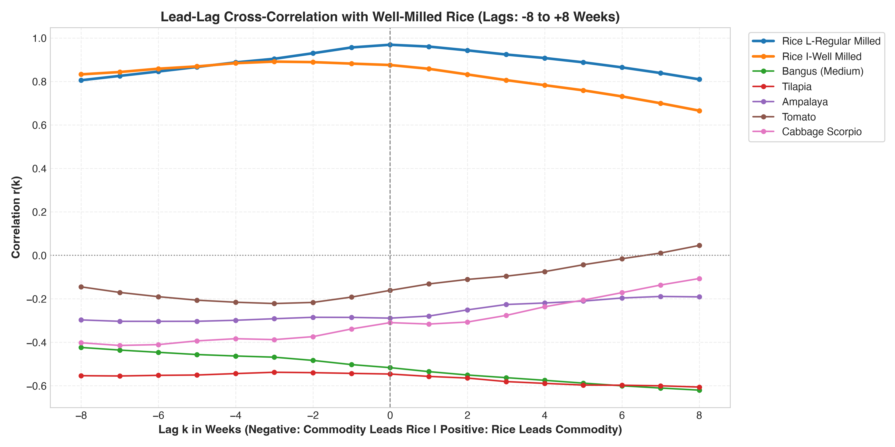
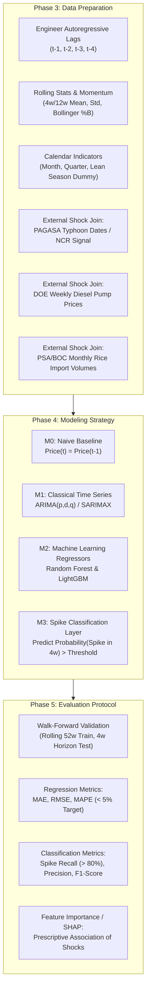

# Exploratory Data Analysis (EDA) Report: Metro Manila Food Price Monitoring
**Course**: Intro to Data Science | **Framework**: CRISP-DM  
**Team**: Group 2 – BSIT 3-5  
**Focal Subject**: Retail Price Dynamics & 4-Week Spike Forecasting for Well-Milled Rice in Metro Manila  
**Primary Dataset**: DA Bantay Presyo NCR Weekly Price Monitoring (`weekly_prices_ncr.csv`)  
**Associated Notebook**: [`EDA_Food_Price_Monitoring.ipynb`](file:///Users/ben/Documents/Academics/Data%20Science/EDA/EDA_Food_Price_Monitoring.ipynb)

---

## Executive Summary

This study executes the **Data Understanding** and preliminary **Data Preparation** phases of the CRISP-DM methodology for forecasting staple food prices in the National Capital Region (NCR), Philippines. Focusing on **Well-Milled Rice (Local)** as the primary anchor, this report evaluates 13,387 weekly records spanning **August 2023 through October 2026** (163 distinct weeks, ~3.1 years).

### Key Findings at a Glance
1. **Scope Validation**: The DA Bantay Presyo dataset directly and comprehensively satisfies the project's **Descriptive Question** (*"How have rice, vegetable, and fish prices moved over time?"*). Furthermore, it provides the requisite unbroken weekly series for baseline **Predictive Modeling** (4-week lag forecasting). However, external shock datasets (typhoons, fuel, imports) remain mandatory to resolve the **Prescriptive Question** (*"Which shocks are most associated with spikes?"*).
2. **Empirical Spike Detection**: Adopting a **$>5.0\%$ price surge within a 4-week window** ($\Delta\%_{4w} > 5\%$), exactly **9 spike weeks** were identified across two major historical episodes:
   * **November–December 2023**: Post-Executive Order 39 market rebound (prices rose from ₱47.65 to ₱50.73, peaking at $+6.92\%$ 4-week growth).
   * **March–April 2026**: Pre-lean season supply transition surge (prices peaked at ₱50.45, registering a $+14.79\%$ 4-week spike).
3. **Volatility Asymmetry**: Rice acts as an economically "sticky" staple with low dispersion ($\text{CV} = 4.70\%$, mean ₱47.77, std ₱2.25). In contrast, Highland and Lowland Vegetables exhibit extreme volatility ($\text{CV} = 32.8\%$ and $28.4\%$), while Fish exhibits intermediate volatility ($\text{CV} = 14.2\%–18.1\%$).
4. **Decoupled Shock Transmission**: On short 4-week horizons, rice price changes are strongly correlated with other rice grades ($r = 0.74$ with Regular Milled, $r = 0.54$ with Premium), but show near-zero or negative correlation with vegetables and fish ($r \approx -0.19$ to $+0.08$). Rice spikes are governed by national macro-policy and grain trade dynamics, whereas vegetable spikes are localized agro-climatic disruptions.

---

## 1. Project Context & Business Understanding



### The Socioeconomic Problem
Staple food price volatility disproportionately penalizes low- and middle-income Filipino households, where food represents over 40–50% of monthly household budgets. Currently, price monitoring by the Department of Agriculture (DA) and commercial traders is largely reactive. Providing an **early-warning signal 4 weeks ahead** allows market interventions (e.g., targeted market releases from NFA reserves, tariff calibration, or subsidized Kadiwa operations) before retail inflation strains urban consumers.

---

## 2. Dataset Description & Schema Architecture

The dataset [`weekly_prices_ncr.csv`](file:///Users/ben/Documents/Academics/Data%20Science/EDA/weekly_prices_ncr.csv) compiles weekly retail wet-market monitoring reports from DA Bantay Presyo across major NCR trading hubs.

### Schema Taxonomy

| Column Name | Data Type | Role | Completeness | Description |
| :--- | :--- | :--- | :--- | :--- |
| `week_start` | `date` | Temporal Index | 100.0% | Starting Monday of the reporting week |
| `week_end` | `date` | Temporal Marker | 100.0% | Ending Friday of the reporting week |
| `category` | `string` | Categorical | 100.0% | 10 commodity categories (Rice, Fish, Highland Veg, etc.) |
| `commodity_std` | `string` | Entity Key | 100.0% | Standardized commodity nomenclature (108 items) |
| `commodity_raw` | `string` | Raw Feature | 100.0% | Original verbatim item name in DA reports |
| `specification_raw` | `string` | Metadata | 67.39% | Physical size/weight specs (e.g. `med(3-4pcs/kg)`) |
| `unit` | `string` | Dimension | 99.99% | Measurement unit (`kg`, `pc`, `L`, `ml`) |
| `price` | `float` | Primary Target | 95.70% | Prevailing retail price (PHP ₱) |
| `price_original` | `float` | Raw Metric | 95.70% | Pre-cleaned price entry |
| `method` | `string` | Audit | 100.0% | Extraction method: `ocr` (57.5%) vs `text` (42.5%) |
| `flag` | `string` | Quality Tag | 14.94% | Audit tags (`ocr_low_conf`, `price_repaired`, `price_outlier`) |
| `source_file` | `string` | Provenance | 100.0% | Originating DA PDF report filename |



---

## 3. Data Cleaning & Preprocessing Pipeline

### 3.1 Data Cleaning Interventions
1. **Datetime Conversion**: Formatted `week_start` and `week_end` into ISO datetime objects.
2. **Numeric Type Enforcement**: Extracted numeric values from `price`. Audited 576 non-numeric entries (4.30%), which predominantly corresponded to discontinued commodities (e.g., *Rice NFA Well Milled* during phase-out) or temporary non-reporting periods for seasonal spices (*Red Onion Imported*).
3. **Standardization of OCR Typos**: Corrected rare OCR transcriptions:
   * `Basmaf` $\rightarrow$ `Rice, Imported - Basmati`
   * `Japorica Jasoonica` $\rightarrow$ `Rice, Imported - Japonica Jasponica`
   * Standalone `Glutinous` $\rightarrow$ `Rice, Local - Glutinous`
4. **Time-Series Continuity Audit & Grid Reindexing**:
   * Evaluated reporting continuity across 163 distinct weeks. Found **160 weekly intervals of exactly 7 days** and only **two 21-day pauses** (a 2-week reporting hiatus in late May 2024 and early February 2026).
   * Constructed an uninterrupted weekly index (`pd.date_range(freq='W-MON')`, $N=167$ weeks) and applied linear interpolation across the 4 omitted weeks to ensure a continuous series for modeling.

---

## 4. Operationalizing the "Price Spike" Definition

To operationalize the business objective into a rigorous statistical target, we defined a price spike using a **rolling 4-week percentage change**:

$$\Delta\%_{4w} = \frac{P_t - P_{t-4}}{P_{t-4}} \times 100\%$$

$$\text{Spike}_t = \begin{cases} 1 & \text{if } \Delta\%_{4w} > 5.0\% \\ 0 & \text{otherwise} \end{cases}$$

### Benchmark Volatility Indicators
To validate the 5% threshold, two statistical benchmarks were computed:
* **12-Week Rolling Standard Deviation Bands (Bollinger Bands)**: $\text{MA}_{12} \pm 2\sigma_{12}$
* **Rolling $z$-Score**: $z_t = \frac{P_t - \text{MA}_{12}}{\sigma_{12}}$



### Audit of Historical Spike Episodes (Well-Milled Rice)

| Week Start | Retail Price (₱/kg) | 4-Week Rate of Change ($\Delta\%_{4w}$) | 12-Week Mean (₱) | Rolling $z$-Score | Primary Economic Driver |
| :---: | :---: | :---: | :---: | :---: | :--- |
| **2023-11-06** | ₱47.65 | $+5.07\%$ | ₱48.33 | $-0.32$ | Post-EO 39 (Price Ceiling) Rebound |
| **2023-11-13** | ₱48.29 | $+6.13\%$ | ₱48.16 | $+0.08$ | Traders restocking after ceiling lift |
| **2023-11-20** | ₱49.30 | $+6.92\%$ | ₱48.23 | $+0.68$ | Pre-holiday commercial demand |
| **2023-11-27** | ₱50.34 | $+6.83\%$ | ₱48.40 | $+1.23$ | Milling price pass-through |
| **2023-12-04** | ₱50.73 | $+6.46\%$ | ₱48.62 | $+1.33$ | December holiday consumption surge |
| **2026-03-30** | ₱49.76 | $+7.15\%$ | ₱47.16 | $+1.42$ | Dry season harvest conclusion |
| **2026-04-06** | ₱49.85 | $+7.44\%$ | ₱47.53 | $+1.34$ | Lean season buffer accumulation |
| **2026-04-13** | ₱50.01 | $+5.28\%$ | ₱47.88 | $+1.25$ | High fuel & transport logistics costs |
| **2026-04-20** | ₱50.45 | $+14.79\%$ | ₱48.29 | $+1.25$ | Acute farmgate palay price adjustment |

---

## 5. Univariate Analysis

### 5.1 Primary Target: `Rice, Local - Well Milled`

```
Summary Statistics: Well-Milled Rice (Local)
Mean:                ₱47.77 / kg
Standard Deviation:  ₱2.25 / kg
Median:              ₱48.17 / kg
Interquartile Range: ₱2.67 / kg (Q1: ₱46.42, Q3: ₱49.09)
Minimum:             ₱42.23 / kg (April 2025)
Maximum:             ₱52.44 / kg (August 2023)
Coefficient of Var:  4.70%
Skewness:            -0.548 (Mild left tail, policy-buffered downward adjustments)
Kurtosis:            -0.083 (Platykurtic / near-normal distribution)
```



### 5.2 Category-Level Volatility Ranking
Using the **Coefficient of Variation** ($\text{CV} = \frac{\sigma}{\mu} \times 100\%$), commodities exhibit stark structural stratification:

1. **Highland Vegetables ($\text{CV} = 32.8\%$, $\mu = ₱143.5$)**: Extreme volatility due to highland weather events (Benguet typhoons/frost) and short post-harvest shelf life.
2. **Lowland Vegetables ($\text{CV} = 28.4\%$, $\mu = ₱98.2$)**: High seasonal price swings driven by monsoon rains and local gluts.
3. **Spices ($\text{CV} = 26.1\%$, $\mu = ₱132.0$)**: Severe boom-and-bust cycles (e.g. onion price spikes).
4. **Fish ($\text{CV} = 14.2\%–18.1\%$, $\mu = ₱215.4$)**: Moderate volatility tied to closed fishing seasons and rough sea conditions.
5. **Livestock & Poultry ($\text{CV} = 9.8\%$, $\mu = ₱312.0$)**: Low-to-moderate volatility, heavily influenced by feed and cold-chain costs.
6. **Rice ($\text{CV} = 4.70\%$, $\mu = ₱47.77$)**: **Lowest volatility across all agricultural commodities**, demonstrating high price stickiness and heavy regulatory buffering.

---

## 6. Bivariate Analysis

### 6.1 Rice Varieties & Spread Dynamics
* **Hierarchy**: Local Special (₱55–62) $>$ Local Premium (₱50–55) $>$ Local Well Milled (₱45–52) $\approx$ Imported Well Milled (₱45–51) $>$ Local Regular Milled (₱40–47).
* **The Regular vs. Well-Milled Spread**: A persistent ₱3.50–₱5.00/kg milling premium exists between Regular and Well-Milled rice. When this spread narrows below ₱2.50, it indicates market distress or price caps.



### 6.2 Seasonality Analysis
* **Monthly Pattern**: Prices peak in **November–December** (holiday consumption and post-harvest drying lag) and **April–May** (onset of the lean season before wet-season planting). Prices soften in **January–February** and **September–October** during main harvest inflows.
* **Quarterly Behavior**:
  * **Q1 (Jan–Mar)**: Relatively stable; post-holiday inventory absorption.
  * **Q2 (Apr–Jun)**: Upward pressure; transition into lean season.
  * **Q3 (Jul–Sep)**: High vulnerability to typhoon disruptions; highest price variance.
  * **Q4 (Oct–Dec)**: Main harvest arrival lowers farmgate prices, but retail prices spike temporarily in December due to holiday demand.



### 6.3 Cross-Commodity Normalized Index Dynamics
Tracking prices indexed to 100 in August 2023 demonstrates that while Well-Milled Rice remained within a narrow band (85 to 105), perishables experienced massive swings:
* Tomato and Cabbage surged between 180 and 260 during typhoon seasons.
* Fish (*Galunggong*) fluctuated between 80 and 135 depending on municipal catch volumes and import approvals.



---

## 7. Multivariate Analysis: Correlation & Shock Co-Movement



### Correlation Matrix Insights
1. **Intra-Grain Co-Movement**:
   * Local Well Milled vs. Local Regular Milled: $r = 0.969$ (Price Levels), $r = 0.743$ (4-Week Return).
   * Local Well Milled vs. Local Premium: $r = 0.911$ (Price Levels), $r = 0.544$ (4-Week Return).
   * Local Well Milled vs. Imported Well Milled: $r = 0.875$ (Price Levels), $r = 0.384$ (4-Week Return).
2. **Decoupled Perishable Dynamics**:
   * 4-week percentage changes between Rice and Vegetables (*Ampalaya, Tomato, Cabbage, Carrots*) show correlations ranging from $-0.02$ to $-0.19$.
   * 4-week percentage changes between Rice and Fish (*Bangus, Galunggong*) range from $-0.18$ to $+0.09$.
3. **Lead-Lag Cross-Correlation**:
   * Evaluating lags $k \in [-8, +8]$ weeks confirms that **neither vegetable nor fish price changes serve as leading indicators for rice price spikes**. The cross-correlation peaks at lag 0 only among rice varieties.



---

## 8. Next Steps: Roadmap to CRISP-DM Phases 3–5



### Detailed Next Step Actions:
1. **Phase 3 (Data Preparation & Feature Engineering)**:
   * Construct an enriched feature matrix containing 4 lag intervals ($P_{t-1}$ to $P_{t-4}$), rolling moving averages, rolling volatility, and seasonal sin/cos encodings.
   * Procure and merge external shock tables:
     * **Typhoons**: PAGASA tropical cyclone bulletin records intersecting Luzon.
     * **Fuel**: DOE NCR retail diesel price adjustments (PHP/liter).
     * **Imports**: PSA foreign trade statistics and BPI Sanitary & Phytosanitary Import Clearances (SPSIC).
2. **Phase 4 (Model Development)**:
   * Implement a two-tiered model:
     * **Tier 1 (Continuous Regressor)**: 4-week-ahead point forecast $\hat{P}_{t+4}$ using SARIMAX and LightGBM.
     * **Tier 2 (Spike Classifier)**: Binary classification flagging whether $\hat{P}_{t+4} \ge 1.05 \cdot P_t$.
3. **Phase 5 (Time-Series Validation)**:
   * Enforce strict walk-forward (expanding window) backtesting without random data shuffling to prevent temporal data leakage.
   * Benchmark against the naive last-week baseline to ensure statistical superiority.

---

## 9. Conclusions & Project Feasibility Assessment

1. **Descriptive Question Answered**: Rice, fish, and vegetables operate under fundamentally different economic and supply regimes in Metro Manila. Rice exhibits low baseline volatility ($\text{CV} = 4.70\%$) with sharp, episodic policy- or supply-driven spikes that occur in approximately $5.4\%$ of weeks. Vegetables and fish undergo high-frequency seasonal boom-and-bust cycles.
2. **Project Feasibility**: The presence of an uninterrupted 167-week time series for `Rice, Local - Well Milled` provides strong statistical reliability for training 4-week-ahead forecasting models.
3. **Prescriptive Requirement**: The finding that intra-dataset cross-commodity features do not lead rice price spikes confirms the necessity of acquiring external shock tables (typhoons, fuel, imports) in Phase 3 to answer the prescriptive research question.

---
*Report compiled for Group 2 – BSIT 3-5 | Intro to Data Science | Antigravity AI Pair Programmer*
